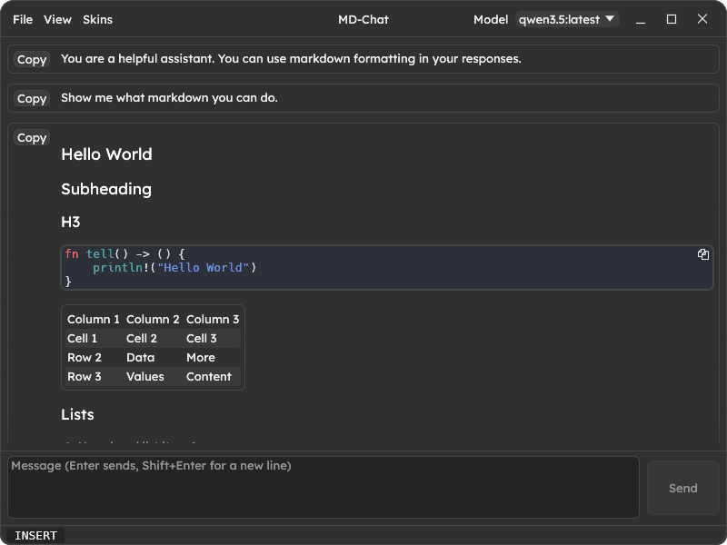

# MD-Chat

A lightweight, fast desktop client for chatting with OpenAI-compatible APIs, with replies rendered
as markdown. Built with [egui](https://github.com/emilk/egui) on
[Patina](https://github.com/Sector-F-Labs/patina), so it shares its window frame and skins with
the other Sector F apps.



## Features

- Talks to a local [Ollama](https://ollama.com) out of the box, or any OpenAI-compatible API
  (OpenAI, [Reservoir](https://github.com/Sector-F-Labs/reservoir), …)
- The model picker lists only the models the API actually has
- Full markdown rendering, with syntax-highlighted code blocks
- Patina skins (Default follows the desktop's light/dark setting; Dark Orange, Steam Classic and
  more built in, or your own in `~/.config/patina/skins/`)
- Vim-style modal keys for reading long conversations
- History from a local Reservoir
- Export a conversation to [CMF](https://sectorflabs.com/cmf/), the Conversational Markdown
  Format, with the Export button or File → Export as CMF… (Ctrl+E)

## Configuration

Settings live in a TOML file, created on first run:

- **Linux:** `~/.config/MD-Chat/config.toml`
- **macOS:** `~/Library/Application Support/MD-Chat/config.toml`

```toml
api_url = "http://localhost:11434"   # requests go to <api_url>/v1/chat/completions
# openai_api_key = "sk-..."          # for APIs that need one
```

- The default `api_url` is a local Ollama. For OpenAI, set `api_url = "https://api.openai.com"`
  and your `openai_api_key`.
- Models come from the API's `/v1/models` list, leaving out embedding models. File → Refresh
  Models fetches it again, for example after `ollama pull`.
- The app also saves the last model, the skin and the title bar setting here.

## Usage

Type a message and press **Enter** to send it; **Shift+Enter** starts a new line. Each message has
a **Copy** button that copies its markdown.

### Modal keys

- **INSERT** mode: type as usual. **Esc** switches to NORMAL mode.
- **NORMAL** mode: **i**, or a click in the input box, goes back to INSERT mode.

The current mode is shown in the status bar.

| Key (NORMAL) | Action |
|--------------|--------|
| `j` / `k` | Scroll down / up a little |
| `Shift+J` / `Shift+K` | Scroll down / up one window height |
| `g` / `G` | Jump to the top / bottom |
| `r` | Refresh history from Reservoir |
| `Ctrl+E` | Export the conversation as CMF (any mode) |
| `Ctrl+Q` | Quit (any mode) |

## Build

```bash
make            # list the targets
make run        # run it
make check      # tests and clippy
make install    # per-user install with a launcher (Linux, PREFIX=~/.local)
make bundle     # target/MD-Chat.app (macOS)
```

Decisions are recorded as ADRs in [docs/adr](docs/adr/README.md).

## License

Licensed under the BSD 3-Clause License. See the LICENSE file for details.
