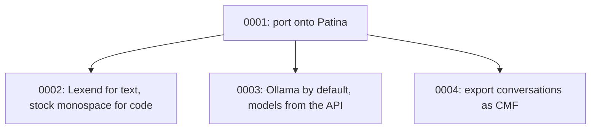

# Architecture Decision Records

This directory holds ADRs for MD-Chat — short records of significant architecture decisions,
written at the time they're made, following Michael Nygard's format as popularized by Martin
Fowler: <https://martinfowler.com/bliki/ArchitectureDecisionRecord.html>.

## When to write one

Write an ADR when a decision is:

- Hard, or expensive, to reverse once other code depends on it.
- Not obvious from reading the code — a "why", not a "what".
- The kind of thing that'll get re-litigated later without a record ("didn't we already decide
  this?").

Small, reversible choices don't need one. Rule of thumb: if you'd want to explain the choice to a
new contributor in a paragraph beyond what the code itself shows, it's ADR-sized.

An ADR is a point-in-time record of *a decision as it was made*, including the options considered
and rejected. It does not get rewritten later — a decision that reverses or replaces an earlier one
gets its own new ADR that supersedes the old one, which stays in place with its status updated.

## Convention

- One file per decision: `NNNN-short-kebab-title.md`, numbered sequentially, zero-padded to 4
  digits. Numbers are never reused, even for a decision that gets reversed.
- Start from [`0000-template.md`](0000-template.md) — copy it, don't write from scratch.
- `Status` is one of: `Proposed`, `Accepted`, `Rejected`, `Deprecated`, or `Superseded by
  ADR-NNNN` (linked to the superseding record).
- Every new ADR gets a row in the index below.
- Keep records short — a paragraph or two per section is normal. An ADR documents a decision and
  its reasoning, not a design document.

MD-Chat is a [Patina](https://github.com/Sector-F-Labs/patina) app. Decisions about the shared
frame, skins and components are recorded in Patina's own ADRs; record here only what this app
decides.

If you're working with Claude Code in this repo, `.claude/skills/adr/SKILL.md` automates the
mechanics of adding one.

## Index

| # | Title | Status |
|---|-------|--------|
| [0001](0001-build-on-patina.md) | Port MD-Chat onto Patina | Accepted |
| [0002](0002-lexend-for-text-stock-monospace-for-code.md) | Lexend for text, stock monospace for code | Proposed |
| [0003](0003-ollama-by-default-models-from-the-api.md) | Ollama by default, models from the API | Accepted |
| [0004](0004-export-conversations-as-cmf.md) | Export conversations as CMF | Accepted |

## Decision Relationship

## Revisit Triggers

- egui_commonmark falls behind Patina's egui version and blocks an upgrade: consider another markdown viewer ([0001](0001-build-on-patina.md)).
- An API MD-Chat should talk to lacks `/v1/models`: bring back a configured model list as a fallback ([0003](0003-ollama-by-default-models-from-the-api.md)).
- Patina gains a font setting in skins: let skins choose the text font instead of Lexend ([0002](0002-lexend-for-text-stock-monospace-for-code.md)).
